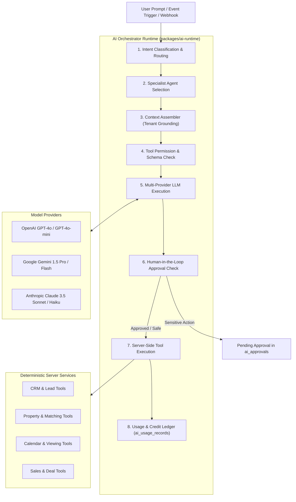

# EstatePilot AI — AI Orchestration & Multi-Agent Architecture

## 1. Central AI Orchestrator Runtime

The AI Orchestrator in `packages/ai-runtime` is the intelligent brain of EstatePilot AI. It sits between user interfaces, background jobs, external webhooks, and foundation LLMs (OpenAI, Gemini, Anthropic).



---

## 2. Multi-Provider LLM Gateway

The runtime abstracts provider-specific APIs behind a unified interface:

```typescript
export interface ModelRequest {
  provider: 'openai' | 'gemini' | 'anthropic';
  model: string;
  temperature?: number;
  maxTokens?: number;
  systemPrompt: string;
  messages: ChatMessage[];
  tools?: ToolDefinition[];
}

export interface ModelResponse {
  content: string | null;
  toolCalls?: ToolCall[];
  tokenUsage: {
    promptTokens: number;
    completionTokens: number;
    totalTokens: number;
  };
  latencyMs: number;
}
```

The system allows administrators to configure provider preferences per agent. For instance:
- **Lead Qualification**: Uses fast, cost-effective models (`gemini-1.5-flash` or `gpt-4o-mini`).
- **Complex Contract Analysis & Legal Property Descriptions**: Uses high-capability models (`claude-3-5-sonnet` or `gpt-4o`).
- **Voice Inbound Streaming**: Uses low-latency voice models.

---

## 3. Tool Registry Architecture (`packages/agent-registry`)

Every tool registered in EstatePilot AI conforms to a strict contract:

1. **Explicit Zod Parameter Schema**: All inputs are validated at runtime before calling the execution handler.
2. **Mandatory Tenant Context**: The active `tenantContext: { organizationId: string; userId: string; role: string }` is automatically injected by the runtime and cannot be overridden by LLM parameters.
3. **Permission Check**: Each tool specifies the required permission key (e.g. `properties:write`, `deals:update`). If the executing user's role lacks the permission, the call is rejected immediately.
4. **Approval Requirement**: High-impact tools (e.g., updating listing prices, publishing public listings, executing binding contract terms) trigger a `PENDING_APPROVAL` record in `ai_approvals` rather than executing directly.

### Registered Initial Tools

```typescript
// 1. search_properties
export const searchPropertiesTool: RegisteredTool = {
  name: 'search_properties',
  description: 'Search properties within the organization using filters such as price, bedrooms, property type, and location.',
  requiredPermission: 'properties:read',
  requiresApproval: false,
  parameters: z.object({
    query: z.string().optional(),
    propertyType: z.enum(['apartment', 'house', 'villa', 'commercial', 'land']).optional(),
    listingType: z.enum(['sale', 'rent']).optional(),
    minPrice: z.number().optional(),
    maxPrice: z.number().optional(),
    minBedrooms: z.number().int().optional(),
    city: z.string().optional(),
    limit: z.number().int().default(10),
  }),
};

// 2. get_property_details
export const getPropertyDetailsTool: RegisteredTool = {
  name: 'get_property_details',
  description: 'Retrieve complete specifications, amenities, and media of a specific property by ID.',
  requiredPermission: 'properties:read',
  requiresApproval: false,
  parameters: z.object({
    propertyId: z.string().uuid(),
  }),
};

// 3. search_leads
export const searchLeadsTool: RegisteredTool = {
  name: 'search_leads',
  description: 'Search leads in the CRM by status, score, source, or text query.',
  requiredPermission: 'leads:read',
  requiresApproval: false,
  parameters: z.object({
    query: z.string().optional(),
    status: z.enum(['new', 'contacted', 'qualified', 'proposal', 'unqualified']).optional(),
    minScore: z.number().optional(),
    assignedToId: z.string().uuid().optional(),
    limit: z.number().int().default(10),
  }),
};

// 4. calculate_lead_score
export const calculateLeadScoreTool: RegisteredTool = {
  name: 'calculate_lead_score',
  description: 'Run the scoring algorithm for a lead based on interactions, timeline, and budget match.',
  requiredPermission: 'leads:write',
  requiresApproval: false,
  parameters: z.object({
    leadId: z.string().uuid(),
  }),
};

// 5. book_property_visit
export const bookPropertyVisitTool: RegisteredTool = {
  name: 'book_property_visit',
  description: 'Schedule a property viewing appointment with calendar availability validation.',
  requiredPermission: 'appointments:write',
  requiresApproval: false,
  parameters: z.object({
    propertyId: z.string().uuid(),
    leadId: z.string().uuid(),
    scheduledAt: z.string().datetime(),
    notes: z.string().optional(),
  }),
};

// 6. update_property_price (Requires Approval)
export const updatePropertyPriceTool: RegisteredTool = {
  name: 'update_property_price',
  description: 'Update the asking or rental price of a property listing. High-impact action.',
  requiredPermission: 'properties:write',
  requiresApproval: true,
  parameters: z.object({
    propertyId: z.string().uuid(),
    newPrice: z.number().positive(),
    reason: z.string(),
  }),
};
```

---

## 4. Human-in-the-Loop (HITL) Workflow

When an agent invokes a tool flagged with `requiresApproval: true`:
1. The execution is paused.
2. An entry is created in `ai_approvals` with status `pending`.
3. The human agent receives an in-app notification and toast alert.
4. The agent can review the proposed changes, inspect the AI's chain of reasoning, and click **Approve** or **Reject**.
5. Upon approval, the tool resumes and applies the change; upon rejection, the agent notes the rationale and terminates the action safely.

---

## 5. Token Metering & AI Credit Ledger

Every single step in an AI run records consumption in `ai_usage_records`:
- `organization_id`: Tenant charged for the run.
- `ai_agent_id`: Specialist agent invoked.
- `model`: Exact model used (e.g. `gpt-4o-2024-08-06`).
- `input_tokens`: Prompt token count.
- `output_tokens`: Completion token count.
- `cost_cents`: Calculated cost based on tenant rate card.
- `duration_ms`: Wall-clock execution time.

When an organization reaches its subscription tier AI credit limit, non-essential AI operations are gracefully paused and agents are alerted to upgrade their quota.
