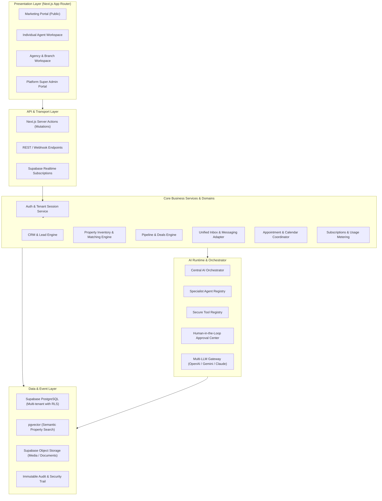
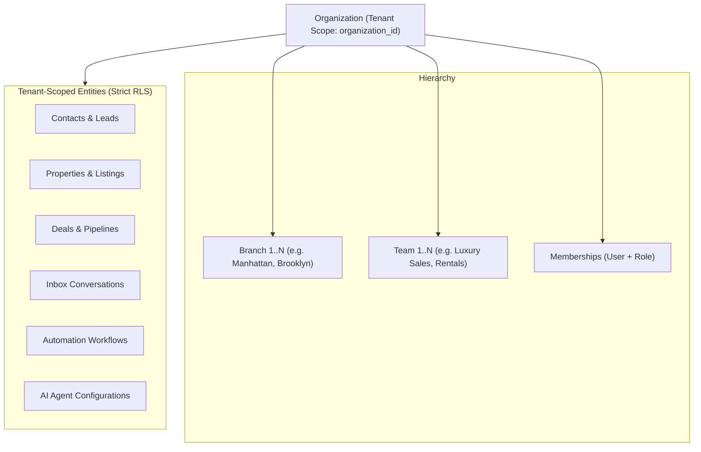

# EstatePilot AI — System Architecture Specification

## 1. Executive Architecture Summary

EstatePilot AI is engineered as a **Modular Monolith** designed for high cohesion, strict domain separation, and horizontal scalability. By enforcing explicit package boundaries and decoupling business logic from web transport layers, the platform achieves enterprise maintainability without the operational overhead of microservices.

---

## 2. Architectural Layers

### Layer 1: Presentation Layer (`apps/web`)
- **Technology**: Next.js 14+ (App Router), React Server Components (RSC), Client Components with hooks, Tailwind CSS, shadcn/ui.
- **Responsibility**: Pure rendering, user interaction, optimistic UI updates, and accessibility.
- **Rules**: Zero raw database queries or direct third-party API calls in components. All data fetching is orchestrated via typed server functions or API routes.

### Layer 2: API & Transport Layer
- **Technology**: Next.js Server Actions, Route Handlers, and Edge Functions.
- **Responsibility**: HTTP parsing, CSRF validation, session resolution, rate limiting, and mapping inputs to business service calls.

### Layer 3: Authentication & Authorization Layer (`packages/auth`, `packages/permissions`)
- **Technology**: Supabase Auth (JWT), server-side session cookies, cryptographically hashed invitations (SHA-256), active tenant cookie synchronization, and comprehensive RBAC engine.
- **Responsibility**:
  - Validates user identity via Supabase Auth.
  - Resolves active `organization_id` strictly verified against database memberships.
  - Enforces role-based permissions (`hasPermission`, `requirePermission`, `requireBranchAccess`, `requireTeamAccess`).
  - Implements atomic organization onboarding via `create_organization_with_owner`.
  - Enforces tenant isolation before invoking any business service.

### Layer 4: Business Service Layer
- **Technology**: Pure TypeScript service classes/modules.
- **Responsibility**: Encapsulates all real estate domain rules, calculations (e.g. commission splits, lead scoring, matching algorithms), state machines, and transactional boundaries.
- **Rules**: Returns deterministic `Result<T, E>` types. Throws only for fatal, unrecoverable runtime errors.

### Layer 5: AI Runtime & Orchestration Layer (`packages/ai-runtime`, `packages/agent-registry`)
- **Technology**: Multi-provider LLM adapter (OpenAI Responses API, Gemini SDK, Anthropic SDK).
- **Responsibility**: Context preparation, tool resolution, agent execution loops, safety guardrails, token accounting, and approval gate checks.

### Layer 6: Database & Storage Layer (`packages/database`, `supabase/`)
- **Technology**: Supabase PostgreSQL with `pgvector`, Row-Level Security (RLS) policies, foreign-key cascade protections, and automated triggers.
- **Responsibility**: Relational persistence, vector similarity search, audit logging, and object storage for listing assets.

### Layer 7: Observability & Security Layer
- **Technology**: OpenTelemetry, Sentry, structured JSON logging, and `audit_logs` table.
- **Responsibility**: Error tracking, latency tracing, anomalous tenant access alerts, and compliance auditing.

---

## 3. Multi-Tenant Organization Hierarchy

EstatePilot AI implements a flexible, multi-tier organizational model:

### Organization Types
1. **Individual**: Solo broker or agent operating as an autonomous single-seat workspace.
2. **Agency**: Multi-agent boutique brokerage with shared listings, lead routing, and centralized inbox.
3. **Enterprise**: Multi-branch, multi-team national brokerage with hierarchical management, custom roles, and global reporting.

---

## 4. Cross-Tenant Data Isolation Guardrails

1. **Mandatory `organization_id`**: Every business entity table must have a non-nullable `organization_id UUID REFERENCES organizations(id) ON DELETE CASCADE`.
2. **PostgreSQL Row Level Security (RLS)**: Enabled on 100% of tenant tables. Unauthenticated queries return zero rows.
3. **Helper Security Functions**:
   - `auth.uid()`: Extracts user ID from validated JWT.
   - `current_user_org_ids()`: Returns all active organization IDs for the current user.
   - `is_org_member(target_org_id)`: Security-definer function validating active membership.
4. **Service-Role Boundary**: Direct usage of `service_role` key is strictly prohibited in frontend code and standard API routes. Only background workers, migrations, and super-admin audited operations utilize elevated permissions.
