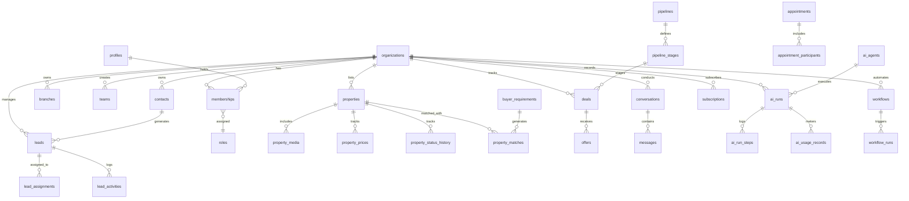

# EstatePilot AI — Database Schema & Architecture Specification

## 1. Relational Schema Architecture

EstatePilot AI utilizes a multi-tenant relational schema on PostgreSQL with `uuid-ossp`, `pgcrypto`, `vector`, and `citext` extensions.

---

## 2. Domain Entities & Normalized Tables

### 2.1 Identity & Tenant Domain
- `profiles`: Extends `auth.users` with personal profile details (first_name, last_name, avatar_url, phone, time_zone, locale).
- `organizations`: Root tenant entity (name, slug, org_type: `individual` | `agency` | `enterprise`, currency, settings).
- `memberships`: Links `profile_id` and `organization_id` with active role and status (`active`, `invited`, `suspended`).
- `organization_invitations`: Pending invitations with SHA-256 token hashing, expiration, and role assignment.
- `roles`: Tenant or system role definitions (`super_admin`, `org_owner`, `org_admin`, `branch_manager`, `team_lead`, `senior_agent`, `agent`, `support_staff`).
- `permissions`: Granular capabilities across the 28 modules.
- `role_permissions`: Mapping of roles to permissions.
- `branches`: Physical or operational branch offices under an organization.
- `teams`: Sub-units within an organization or branch.
- `team_members`: Associates members with specific teams.

### 2.2 CRM & Lead Domain
- `contacts`: Central directory for individuals (buyers, sellers, external agents, partners, vendors).
- `leads`: Prospective clients linked to a contact, tracking intent, qualification, and stage.
- `lead_assignments`: History of agent assignments for each lead.
- `lead_activities`: Chronological timeline of events, status changes, visits, and touches.
- `lead_sources`: Marketing origin attribution (website, Zillow, Realtor, WhatsApp, referral, cold-call).
- `tasks`: Action items assigned to agents with due dates and priority.
- `notes`: Rich text notes attached to leads, contacts, or properties.
- `tags`: Reusable categorization labels.
- `entity_tags`: Polymorphic junction for tagging leads, contacts, properties, and deals.
- `custom_fields`: Tenant-configurable dynamic schema extensions.

### 2.3 Property Inventory Domain
- `properties`: Core real estate asset (title, slug, property_type, listing_type, status, headline, description, embedding).
- `property_addresses`: Precise geolocation, street, unit, postal_code, city, state, country, lat, lng.
- `property_details`: Specifications (bedrooms, bathrooms, half_baths, square_feet, lot_size, year_built, stories, parking_spaces).
- `property_media`: High-res photos, 3D tours, floor plans, and video links with display order and classification.
- `property_owners`: Association to contacts who own the property.
- `property_prices`: Pricing history, original price, current asking price, rental rate, HOA fees, property taxes.
- `property_status_history`: Audit trail of transitions (`draft`, `active`, `pending`, `under_contract`, `sold`, `leased`, `withdrawn`).
- `property_features`: Master library of property amenities and architectural features.
- `property_feature_links`: Many-to-many junction linking properties to features.
- `property_documents`: Secure title deeds, inspection reports, disclosure forms.

### 2.4 Requirements & Matching Engine Domain
- `buyer_requirements`: Structured demand profile (budget_min, budget_max, preferred_types, min_beds, min_baths, location_preferences).
- `requirement_locations`: Geo-polygons or target neighborhoods for buyer preference.
- `requirement_features`: Desired vs must-have property amenities.
- `seller_requirements`: Mandate details for property sellers (target closing date, minimum net proceeds).
- `property_matches`: Scored pairings between buyer requirements and properties with deterministic match scores and AI rationale.

### 2.5 Sales & Pipeline Domain
- `pipelines`: Configurable sales funnels (e.g. "Residential Purchase", "Commercial Lease", "Off-Market").
- `pipeline_stages`: Ordered milestone steps within a pipeline (e.g. "New", "Viewing Conducted", "Offer Made", "Closing").
- `deals`: Commercial deal cards moving across stages with expected value, probability, and closing date.
- `deal_activities`: Milestone records and status changes on a deal.
- `offers`: Formal purchase/lease proposals with contingencies, deposit, and status.
- `commissions`: Detailed commission splits between agency, listing agent, buyer agent, and broker.
- `transactions`: Recorded financial closings and escrow disbursement tracking.
- `contracts`: Digital document references, countersignature status, and contract expiry.

### 2.6 Communication & Inbox Domain
- `conversations`: Multi-channel unified communication threads (WhatsApp, Email, SMS, Web Chat).
- `messages`: Individual inbound and outbound messages with status (`sent`, `delivered`, `read`, `failed`).
- `communication_accounts`: Connected provider credentials (WhatsApp Cloud API, Gmail OAuth, Twilio).
- `message_templates`: Reusable message templates with variable tokens.
- `appointments`: Scheduled property viewings, appraisals, and client meetings.
- `appointment_participants`: Attendees linked to the appointment.
- `appointment_events`: Sync history with external calendars (Google Calendar, Outlook).
- `call_logs`: Telephony logs with duration, recording URL, transcription, and AI sentiment analysis.
- `consent_records`: GDPR/TCPA compliance tracking for opt-ins and disclosures.
- `suppression_lists`: Unsubscribes and do-not-contact lists.

### 2.7 AI Orchestration Domain
- `ai_agents`: Registered specialist agents (Lead Intelligence, Voice, Matching, etc.).
- `ai_agent_versions`: Version-controlled instructions, prompts, and tool sets.
- `ai_agent_tools`: Reusable capability definitions with JSON schemas for arguments.
- `ai_runs`: Execution runs invoked by users, webhooks, or workflows.
- `ai_run_steps`: Granular steps inside an AI run (thought, tool_call, tool_result, message).
- `ai_conversations`: LLM session memory and dialogue threads.
- `ai_memory`: Long-term key-value or vector memory for client preferences and context.
- `ai_knowledge_sources`: Ingested knowledge documents (agency policies, local HOA rules, brochures).
- `ai_knowledge_chunks`: Text chunks with 1536-dim vectors for RAG retrieval.
- `ai_approvals`: Human-in-the-loop pending approval requests.
- `ai_usage_records`: Token counts, execution duration, provider costs, and tenant attribution.
- `ai_prompt_versions`: Auditable history of prompt modifications.

### 2.8 Automation & Workflows Domain
- `workflows`: Visual automated recipes with metadata.
- `workflow_versions`: Versioned workflow node and edge graphs.
- `workflow_runs`: Execution instances of a workflow.
- `workflow_run_steps`: Individual node execution results and payloads.
- `workflow_triggers`: Event subscriptions that trigger workflows.
- `integrations`: Connected external services (n8n, MLS, Zapier, Webhooks).
- `integration_secrets`: Server-side encrypted credentials.
- `webhook_endpoints`: Registered outgoing webhook targets.
- `webhook_events`: Idempotent log of dispatched webhook payloads.
- `scheduled_jobs`: Periodic background jobs (cron-style task runner).

### 2.9 Billing & Subscriptions Domain
- `plans`: Commercial pricing plans (`Free Trial`, `Starter`, `Professional`, `Agency`, `Enterprise`).
- `subscriptions`: Active customer billing accounts with Stripe / Razorpay customer and subscription IDs.
- `subscription_items`: Line-item breakdown (base fee, additional seat licenses).
- `invoices`: Generated and paid invoice records.
- `payments`: Transaction confirmations with gateway references.
- `usage_limits`: Tier-based caps (max active properties, monthly AI credits, team seats).
- `usage_records`: High-water mark and cumulative metric consumption.

### 2.10 Administration & Audit Domain
- `platform_admins`: Super-admin accounts with global platform privileges.
- `audit_logs`: Append-only security ledger (user, tenant, action, entity, before_payload, after_payload, IP, user_agent).
- `system_settings`: Global platform operational parameters and feature flags.

---

## 3. Database Indexes & Performance Optimization

Every tenant-scoped table features:
1. Primary index: `PRIMARY KEY (id)` (UUIDv4).
2. Tenant composite index: `CREATE INDEX idx_<table>_org_id ON <table> (organization_id)`.
3. Filter & Sort composite indexes: e.g. `CREATE INDEX idx_properties_org_status_price ON properties (organization_id, status, current_price)`.
4. Vector Index: `CREATE INDEX idx_properties_embedding ON properties USING ivfflat (embedding vector_cosine_ops) WITH (lists = 100)`.
5. Soft Deletion Filter: `WHERE deleted_at IS NULL` on all active entity queries.
