# EstatePilot AI — 10-Phase Implementation Roadmap

This document outlines the systematic, verified development plan for EstatePilot AI. Each phase establishes clean foundations, passes automated tests, and delivers documented software before progressing to subsequent phases.

---

## Roadmap Overview

```mermaid
flowchart LR
    P0["Phase 0: Foundation & Design"] --> P1["Phase 1: Multi-Tenant Auth & RLS"]
    P1 --> P2["Phase 2: CRM & Pipelines"]
    P2 --> P3["Phase 3: Property Matching"]
    P3 --> P4["Phase 4: AI Orchestration"]
    P4 --> P5["Phase 5: AI Customer Chat"]
    P5 --> P6["Phase 6: Comms & Calendar"]
    P6 --> P7["Phase 7: Sales & Workflows"]
    P7 --> P8["Phase 8: Billing & BI"]
    P8 --> P9["Phase 9: Hardening & Prod"]
```

---

## Phase Breakdown & Deliverables

### Phase 0: Foundation, Architecture & Design System (COMPLETED)
- **Scope**: Repository monorepo structure, package boundaries, base database schema migrations, multi-tenant database helpers, design system primitives, and developer tooling.
- **Deliverables**:
  - Monorepo structure (`apps/web`, `packages/*`, `supabase/*`, `docs/*`, `tests/*`).
  - Master documentation (`README.md`, `AGENTS.md`, `docs/*`, `.env.example`).
  - PostgreSQL migration foundation with `uuid-ossp`, `pgcrypto`, `vector`, `citext`.
  - Core identity schema (`profiles`, `organizations`, `memberships`, `roles`, `permissions`, `audit_logs`).
  - Enterprise Design System: Dark Navy & Slate/White theme, typography, layout shells.
  - Test harness setup with Node native test runner.
- **Status**: Verified & Completed.

---

### Phase 1: Authentication, Organizations, Memberships, Roles & RLS (COMPLETED)
- **Scope**: Supabase Auth integration, session persistence, active tenant switcher, invitation lifecycle with SHA-256 token hashing, atomic organization onboarding, privilege escalation prevention trigger, and comprehensive PostgreSQL RLS policies.
- **Deliverables**:
  - Migration `20261031000000_phase1_auth_rls.sql` with search_path hardening, invitations table, and escalation trigger.
  - Real Auth flows: Registration, Login, Logout, Forgot Password, Reset Password.
  - Active tenant context resolution with secure cookie synchronization (`estatepilot_active_org`).
  - Atomic Organization onboarding (`create_organization_with_owner` stored procedure).
  - Member invitation engine with SHA-256 cryptographic token hashing, expiration, and acceptance.
  - 8 core roles RBAC methods: `hasPermission`, `requirePermission`, `requireOrganizationMembership`, `requireActiveOrganization`, `requireBranchAccess`, `requireTeamAccess`.
  - 47 automated tests verifying tenant isolation, negative RLS scenarios, privilege escalation blocking, and invitation consumption.
- **Status**: Verified & Completed.
- **Acceptance Criteria**:
  - User can belong to multiple organizations and switch context seamlessly.
  - Negative tests confirm Org A cannot query Org B data under any circumstance.

---

### Phase 2: CRM, Contacts, Leads, Tasks & Pipelines
- **Scope**: Unified contact directory, lead capture, automated lead scoring, activity timelines, task management, and sales pipelines.
- **Deliverables**:
  - Contact management with buyer/seller tags and custom fields.
  - Lead lifecycle state machine (`new` -> `contacted` -> `qualified` -> `negotiation` -> `closed` / `lost`).
  - Algorithmic lead scoring service.
  - Interactive Kanban board and tabular data grid for leads and deals.
  - Activity stream and automated reminder tasks.
- **Acceptance Criteria**:
  - Full CRUD operations with server-side validation and audit logging.
  - Real-time lead assignment to branch/team members.

---

### Phase 3: Property Management, Media Vault, Buyer Requirements & Matching
- **Scope**: Residential & commercial property inventory, media upload to Supabase Storage, buyer requirements, and deterministic matching engine.
- **Deliverables**:
  - Rich property editor with multi-unit specs, amenities, and floor plans.
  - Multi-currency, metric/imperial area conversions.
  - Buyer requirement profiles with budget, bedrooms, and location preferences.
  - Deterministic property matching engine (hard filters + weighted compatibility scoring).
  - Match deck generation and comparison matrix.
- **Acceptance Criteria**:
  - Property search executes in <100ms across 10,000+ indexed listings.
  - Matching engine produces 100% deterministic, explainable scores without hallucination.

---

### Phase 4: AI Runtime, Agent Registry, Tool Registry & Approval Center
- **Scope**: Central AI Orchestration runtime, multi-provider LLM gateway, 11 specialist agents registry, secure tool calling, and HITL approval workflow.
- **Deliverables**:
  - `packages/ai-runtime` orchestrator with intent classifier and context assembler.
  - Reusable Tool Registry with Zod argument validation and RBAC checks.
  - Human-in-the-Loop Approval Center for high-impact actions (price modifications, publishing).
  - Token metering and credit accounting in `ai_usage_records`.
- **Acceptance Criteria**:
  - Agents strictly invoke approved tools with verified organization scope.
  - Sensitive operations pause in `PENDING_APPROVAL` status until an authorized user signs off.

---

### Phase 5: AI Customer Chat & Lead Qualification
- **Scope**: Embeddable website chat widget, real-time customer conversation agent, automated lead qualification, and property inquiry handling.
- **Deliverables**:
  - Customer Chat UI with responsive mobile and desktop drawer.
  - Conversational AI agent answering inquiries using verified inventory only.
  - Dynamic qualification flow capturing budget, timeline, and financing status.
  - Automatic conversion from chat conversation to CRM lead with transcript.
- **Acceptance Criteria**:
  - Zero hallucination of unlisted property attributes.
  - Captured leads accurately flow into the CRM with qualification score.

---

### Phase 6: Communication Hub & Appointment Scheduling
- **Scope**: Unified inbox (WhatsApp Cloud API, Gmail, SMS), appointment coordinator, and bi-directional calendar synchronization.
- **Deliverables**:
  - Unified Inbox UI aggregating multi-channel threads.
  - Webhook handlers with cryptographic signature verification for WhatsApp & Gmail.
  - Property viewing appointment booking engine with buffer times and conflict detection.
  - Google Calendar / Outlook two-way synchronization.
  - Automated WhatsApp/Email viewing reminders and feedback requests.
- **Acceptance Criteria**:
  - Webhook ingestion handles retries and idempotent processing.
  - Calendar appointments never double-book an agent.

---

### Phase 7: Sales, Marketing & Workflow Automation Studio
- **Scope**: Advanced deal closing milestones, commission split calculations, multi-channel marketing generator, and visual node-based workflow engine.
- **Deliverables**:
  - Deal closing workflows with escrow and document compliance tracking.
  - Commission calculator supporting multi-agent and agency splits.
  - Marketing Agent generator for property flyers, social posts, and email newsletters.
  - Visual Workflow Automation Studio (Triggers, Conditions, Actions).
  - Background worker executing scheduled workflows and webhooks.
- **Acceptance Criteria**:
  - Workflows execute reliably with audit logs and retry policies.
  - Marketing materials adhere to agency brand guidelines and property specs.

---

### Phase 8: Analytics, Business Intelligence & Multi-Gateway Billing
- **Scope**: Executive dashboards, agent productivity metrics, conversion funnels, Stripe & Razorpay billing, and AI credit management.
- **Deliverables**:
  - Real-time BI dashboards for Solo Agents, Agency Owners, and Platform Super Admins.
  - Conversion funnel analysis by lead source and branch.
  - Stripe and Razorpay subscription checkout, portal, and webhook handlers.
  - Tiered plan enforcement (`Starter`, `Professional`, `Agency`, `Enterprise`).
  - AI usage quotas, automatic top-ups, and invoice downloads.
- **Acceptance Criteria**:
  - Billing webhooks cryptographically verified; paid features unlock only upon webhook confirmation.
  - Usage limits prevent resource overages across tenants.

---

### Phase 9: Production Hardening, Security Audit & Cloud Deployment
- **Scope**: Security penetration testing, RLS audit, performance tuning, OpenTelemetry & Sentry setup, and Vercel/Supabase production deployment.
- **Deliverables**:
  - Comprehensive automated test suite (Unit, Integration, Negative RLS).
  - Rate limiting, CSRF protections, and secure HTTP security headers.
  - Sentry error monitoring and OpenTelemetry distributed tracing.
  - CI/CD GitHub Actions workflows for automated linting, testing, and deployment.
  - Disaster recovery, backup procedures, and runbooks.
- **Acceptance Criteria**:
  - 100% automated test pass rate.
  - Zero critical security vulnerabilities in automated scans.
  - Production-ready deployment configuration on Vercel and Supabase.
